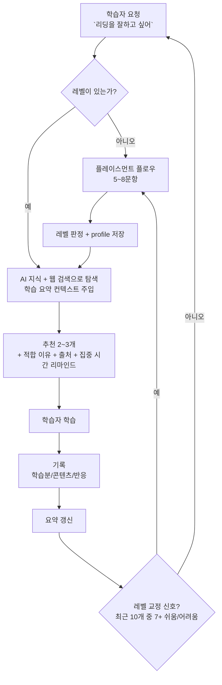
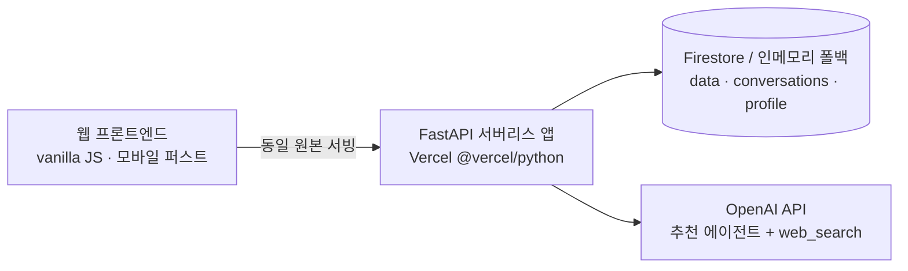

# 서비스 기획서: 가제 "Compass"
**전 연령 영어 학습 콘텐츠 추천 AI 에이전트** (가제)

| 항목 | 내용 |
|------|------|
| 버전 | v0.2 (구현 반영) |
| 날짜 | 2026-07-21 |
| 상태 | 기획 중 |
| 범위 | 80시간 미션 산출물 (개인, 웹 서비스) |
| 포지셔닝 | "Bloomy"(3~6세 데일리 코칭 서비스)와 **별도 서비스** — 큐레이션 방법론·윤리 원칙만 계승 |

## 1. 서비스 개요

**한 줄 요약**: 학습자의 영어 수준(레벨)을 파악하고 학습 이력을 기록해, AI 지식 + 실시간 웹 검색으로 "지금 나에게 맞는 콘텐츠"를 **이유와 함께** 계속 추천해 주는 AI 에이전트 서비스.

- **교육 자체를 제공하지 않는다**: 학습자 수준에 맞는 콘텐츠(유튜브·교재·앱·웹사이트·커뮤니티·팟캐스트 등)를 추천하고, 학습자가 직접 접근하도록 안내
- **카탈로그로 제한하지 않는다**: 미리 준비한 목록이 아니라 AI의 기존 지식 + **실시간 웹 검색**(커뮤니티, 유튜브 등)으로 최신·실제 존재하는 콘텐츠를 탐색
- **추천마다 이유를 설명한다**: "이 학습자에게 왜 적합한지"(레벨 적합성 · 목표와의 연결 · 콘텐츠 특징)를 반드시 함께 제시
- **집중 시간은 핵심 원칙이다**: "스스로 집중해서 들인 시간이 영어를 자라게 한다"는 원칙을 사이트의 상단 섹션에 배치하고, AI 응답에도 매번 리마인드
- **기록·자기 점검을 안내한다**: 학습자 스스로 학습을 기록하고(시간·내용·느낌), 요약을 확인하며 점검하는 방법을 서비스 전체에서 안내
- **일회성 추천이 아니다**: 레벨 판정(플레이스먼트) → 학습 기록 → 요약 → 추천 조정의 **지속 루프**로 설계
- **방법 질문에도 답한다**: "리딩을 잘하고 싶다" 같은 목표 질문뿐 아니라 "리스닝은 어떻게 하는 게 좋을까?" 같은 방법론 질문도 수준에 맞게 답변
- **전 연령대 대상**: 3~6세(부모 대용) ~ 성인까지, 통합 레벨 체계(L1~L6)로 하나의 서비스에서 커버

### 미션 필수 기술 요소 반영

| 기술 요소 | 반영 방식 |
|-----------|-----------|
| FastAPI 프로젝트 구성 | 라우터(data/conversations/chat/profile) / 서비스(store·analysis·ai) / Pydantic 모델 분리 |
| Pydantic 검증 | 모든 POST/PUT 입력 검증(날짜 형식, 학습분 범위, 필드 필수 여부 등) |
| Firestore | 3개 컬렉션: data(학습 기록) · conversations(대화) · profile(프로필). Firebase 미설정 시 인메모리 저장소로 폴백(개발·데모용) |
| 컨텍스트 주입 | "레벨 + 학습 요약"을 시스템 프롬프트에 주입 → 학습자 맞춤형 추천 |
| 대화 자동 저장 | POST /api/chat이 대화 내용을 conversations에 자동 저장 |
| 시계열 데이터 | 학습 기록 (date, value=학습분, memo) — 최소 100개 포인트(시드 스크립트 + 실시간 입력) |
| 배포 | **Vercel 단일 배포** (`@vercel/python`) — API + 프론트엔드 정적 파일을 같은 서버리스 앱에서 서빙. Swagger `/docs` 확인 가능 |
| 키 관리 | OPENAI_API_KEY, FIREBASE_SERVICE_ACCOUNT_JSON, ALLOWED_ORIGINS 전부 환경 변수 |
| (보너스) 웹 검색 | OpenAI `web_search_preview` 도구로 실시간 검색 + `url_citation` 출처를 UI에 표시(모델 미지원 시 지식 전용으로 자동 폴백) |

## 2. 문제 정의

### 2.1 배경

- 영어 자습자가 학습 자료를 찾으면 "이게 최선이야?"라는 답이 커뮤니티마다, 개인마다 제각각이다. 검증된 큐레이션은 파편화되어 있다
- 범용 AI(ChatGPT 등)에 추천을 물으면, 내 **레벨에 맞지 않는 유명 교재 이름**이 돌아온다. 수준 확인 과정이 없고, 나의 학습 이력도 모르기 때문
- 추천을 받아도 진행도가 바뀌면 아무도 콘텐츠를 조정해 주지 않아, 자습은 "중도 포기"로 끝나기 쉽다

### 2.2 해결하려는 문제

| # | 문제 | 설명 |
|---|------|------|
| P1 | 콘텐츠 혼선 | 내 연령·레벨·목적에 뭘 배워야 할지 판단 불가. 신뢰 여부 검증이 어렵다 |
| P2 | 수준 눈먼 추천 | 레벨을 확인하는 과정 없이 모든 추천이 "보편적"이 된다. 자기 수준 판단은 틀리기 쉽다 |
| P3 | 일회성 추천의 단절 | 학습 진행·흥미 변화에 따른 콘텐츠 조정 기전이 없어 지속성이 꺾인다 |

### 2.3 해결 방안

- **P1 → AI 지식 + 실시간 웹 검색 + 이유 설명**: 검증된 큐레이션이 파편화되어 있으므로, AI가 널리 신뢰받는 콘텐츠 지식을 기반으로 하고 최신 정보는 실시간 웹 검색(유튜브·커뮤니티·학습 사이트)으로 탐색하며, 추천마다 "왜 이 학습자에게 적합한지"를 설명하고 확인된 출처 링크를 함께 제시
- **P2 → 통합 레벨 체계(L1~L6) + 채팅 플레이스먼트**: 전 연령 공통 스텁으로 5~8문항으로 레벨을 판정하고, 학습 기록의 반응(쉬움/적정/어려움)으로 재조정
- **P3 → 학습 기록 → 요약 → 조정 루프**: 기록이 요약(총량·평균·추세·스킬 분포)으로 만들어져 컨텍스트에 주입되므로, AI가 계속 달라지는 상황에 맞게 추천

## 3. 타겟 사용자

### 3.1 주요 사용자: 직접 학습자 (13세+)

- 성인(20~40대): 취직·유학·목표 지향적 학습자, "영어를 그냥 즐기고 싶다"는 학습자
- 중·고등학생: 본인이 사용하거나 부모가 대용
- 특징: 챗으로 직접 대화 가능, 목표가 비교적 명확(리딩/리스닝/회화/어휘), 하루 10~30분 학습 시간

### 3.2 보조 사용자: 아동의 부모 (3~6세, 7~12세)

- 서비스를 직접 조작할 수 없는 아이를 대신해 사용
- 질문 형태가 구체적: "오늘 저녁에 뭘 하면 좋을까?", "그림책 뭐 사줘?"
- 아이의 레벨 판정은 부모가 답하는 행동 자기진단형 플레이스먼트로 진행 ("영어로 된 노래를 흥얼거릴까요?", "그림책 문장을 스스로 읽으려 할까요?")

### 3.3 페르소나 예시

| 페르소나 | 프로필 | 대표 질문 |
|---|---|---|
| 직장인 34세 | 성인 · L4 · 목표: 영어 소설 읽기 | "영문 소설, 어디부터 시작해야 해?" |
| 초3 아이의 엄마 | 7-12 · L3 · 하루 20분 | "집에서 영어 뭘 하면 좋을까?" |
| 4세 아이의 아빠 | 3-6 · L2 | "우리 아이에게 그림책 뭐가 좋을까?" |
| 고2 학생 | 13-17 · L5 | "수능 영어 대비로 뭘 하면 좋아?" |

## 4. 서비스 철학

> "영어의 '다음 단계'는 사람마다 다르다.
> 이 서비스의 일은 영어를 진단하는 것이 아니라, **지금 나에게 맞는 콘텐츠를 권하는 것**이다."

- **추천 원천: AI 지식 + 실시간 웹 검색**: 널리 신뢰받는 콘텐츠 지식을 기반으로 하되, 최신·실제 존재 여부를 웹 검색으로 확인. 확인된 출처는 링크로 함께 제시하고, 근거가 불확실하면 확신을 주지 않고 정직하게 표현
- **추천마다 이유 설명**: "왜 이 사람에게 맞는지도" 함께 제시(레벨 적합성, 목표 연결, 콘텐츠 특징)
- **집중 시간이 영어를 자라게 한다**: 추천이 좋더라도 스스로 집중해서 들인 시간이 핵심임을 상단 섹션·AI 응답·기록 안내 전반에서 반복 강조
- **스스로 기록하고 점검한다**: 학습 기록(시간·내용·느낌) → 요약 → 채팅 점검의 방법을 안내해, 학습자가 자신의 학습을 스스로 확인할 수 있게 한다
- **레벨은 추천 도구이지 평가가 아니다**: 사람을 줄 세우거나 등급 매기는 표현("남보다 낮다" 등) 금지. 레벨은 오직 "다음에 뭘 권할지"에 사용
- **기록은 학습자 자신을 위한 것**: 성장 확인(기간·추세) + 더 정확한 다음 추천. 랭킹·게임화 없음
- **AI 명시**: AI가 생성한 추천·메시지는 "AI가 작성했습니다"를 표시
- **진단성 주장 금지**: 발달 평가, 의학적 표현, 향상 효과 보장 표현 금지 (사내 3~6세 서비스 기획에서 확립한 윤리 원칙 계승)
- **진단성 주장 금지**: 발달 평가, 의학적 표현, 향상 효과 보장 표현 금지 (사내 3~6세 서비스 기획에서 확립한 윤리 원칙 계승)

## 5. 레벨 체계 (L1~L6)

### 5.1 설계 원칙

1. **전 연령 통합 단일 스텁**: 하나의 순서 스텁(L1~L6)으로 연령대를 가로지르는 추천·비교가 가능
2. **연령대별 자연 범위**: 각 연령대마다 실제로 시작할 수 있는 레벨 범위가 다르다 (3~6세는 L1부터, 성인 대부분은 L3~L6)
3. **CEFR 앵커 (13세+ 한정)**: 청소년·성인은 CEFR을 참고 앵커로 해석만 지원. 공식 등가로 사용하지 않음
4. **레벨은 동적**: 플레이스먼트로 최초 판정, 학습 기록의 반응으로 재조정

### 5.2 스텁 정의

| 레벨 | 설명 | 3~6세 | 7-12세 | 13세+/성인 |
|---|---|---|---|---|
| L1 | 소리 익숙해지기 (노래·운문의 소리) | 초기 | 드묾 | 드묾 |
| L2 | 기본 듣기 (짧은 지시·문장 이해) | 초기~ | 초기 | 드묾 |
| L3 | 짧은 문장 (모방·산출) | 중기~ | 초기~ | 입문 (≈A1) |
| L4 | 기초 읽기 (그림 지원 쉬운 책) | 후기 | 중기~ | ≈A1-A2 |
| L5 | 쉬운 텍스트 독립 읽기 (짧은 기사, 일상 회화) | — | 후기~ | ≈A2-B1 |
| L6 | 실제 자료 읽기 (소설·뉴스·강의) | — | 고등+ | ≈B1-B2+ |

### 5.3 레벨 판정과 조정

- **최초 판정 (플레이스먼트)**: 채팅으로 5~8문항 — 자기진단 2~3문항 + 실제 소문제 3~5문항 (연령대별 문제 은행)
  - 결과: 레벨 + "왜 이 레벨인지" 1~2문장 근거 설명
- **신뢰도**: AI가 판정 시 신뢰도(높음/낮음)를 명시. 낮음이면 "한 단계 위를 먼저 써 보며 기록으로 조정하자"는 식의 안내
- **재조정 (교정) 규칙**: 최근 10개 기록 중 7개 이상이 "쉬움"(또는 "어려움") 반응이면, AI가 레벨 재점검을 제안
- **재점검 트리거**: ① 학습자의 "레벨 다시 봐줘" 요청 ② 위의 교정 신호 ③ 온보딩 중 목표·연령대 변경

## 6. 콘텐츠 추천 방식 (지식 + 웹 검색)

### 6.1 원칙

1. **카탈로그 제한 없음**: 미리 준비한 목록에 구애받지 않고, AI의 기존 지식과 실시간 웹 검색을 모두 활용
2. **추천마다 적합 이유**: 레벨 적합성 · 목표와의 연결 · 콘텐츠 특징을 1~2문장으로 설명
3. **출처 인용**: 웹 검색에서 확인한 출처는 링크(제목)를 함께 제시 — UI에 "참고 출처"로 표시
4. **무료 우선 · 유료는 명시**: 무료 대안을 함께 제시하고, 유료 콘텐츠는 가격과 무료 대안을 명시
5. **정직성**: 웹 검색으로 존재를 확인하지 못한 구체적 영상·링크는 단정하지 않고 "검색해 볼 것"을 안내

### 6.2 웹 검색 활용 (보너스)

- OpenAI Chat Completions의 `web_search_preview` 도구로 호출 시 실시간 검색
- 응답의 `annotations`에서 `url_citation`(url + title)을 추출해 UI에 출처로 표시
- `ENABLE_WEB_SEARCH=false` 또는 **도구 미지원 모델**이면 AI 지식만으로 응답하도록 자동 폴백 (OpenAIError 감지)
- 검색 결과의 신뢰도는 AI가 판단하며, 출처 링크와 함께 제시해 학습자가 직접 검증할 수 있게 함

### 6.3 연령대별 예시 (AI가 실제로 추천할 수 있는 콘텐츠 예)

| 연령대 | 예시 콘텐츠 |
|---|---|
| 3~6세 | Super Simple Songs (무료), Oxford Reading Tree Stage 0~2, Khan Academy Kids (무료 앱) |
| 7~12세 | Oxford Reading Tree Stage 3~5, British Council LearnEnglish Kids (무료), Lingokids |
| 13~17세 | British Council LearnEnglish Teens (무료), Penguin Readers (그레디드 리더), TED-Ed (무료) |
| 18+ | BBC Learning English (무료), Oxford Bookworms (그레디드 리더), 6 Minute English (팟캐스트) |

> 위 목록은 시드/참고 예시일 뿐, 추천의 범위를 제한하지 않는다. 웹 검색을 통해 최신·커뮤니티 추천·유튜브 채널 등 지식 외 콘텐츠도 탐색 대상이다.

## 7. 핵심 서비스 플로우

### 7.1 첫 실행 (온보딩)

온보딩을 별도 폼 화면이 아닌 **채팅으로 진행** (UI 단순화 + 서비스 성격과 일치):

1. 서비스 취지 안내 첫 메시지 (철학 4절 반영, 1스크린)
2. 프로필 질문: 연령대 → 목표(읽기/듣기/말하기/어휘) → 하루 시간 (3문항)
3. 플레이스먼트 플로우 (5.3절) → 레벨 + 근거 설명
4. 첫 추천: (레벨 + 목표 스킬) 기준으로 2~3개 + 적합 이유 + 사용법 안내

### 7.2 핵심 루프 (추천 루프)



### 7.3 학습 기록

- **필드**: date, value(학습분), memo(콘텐츠명+스킬), reaction(쉬움/적정/어려움)
- **입력 경로**:
  - ① AI 응답 내 기록 유도 (시스템 프롬프트 지침 — 학습 직후 「학습 기록」 탭에 기록하도록 안내)
  - ② 학습 기록 관리 화면에서 수동 입력 (CRUD)
- **역할**: 요약(미션 요구) + 레벨 교정 + 다음 추천의 근거

### 7.4 대화

- 대화는 매 채팅 시점에 자동 저장 (플레이스먼트 Q&A 포함)
- 제목은 첫 사용자 메시지를 축약해 자동 생성 (예: "리딩을 잘하고 싶어")

## 8. AI 활용 방식

### 8.1 에이전트 설계 (학습 컨시어지)

- **역할**: 영어 학습 컨시어지 — 수준·목표에 맞는 콘텐츠 추천 + 학습 방법 조언 + 자기 점검 안내
- **입력**: 사용자 요청 + profile(레벨/연령대/목표/일일 시간) + 학습 요약 + 최근 12개 메시지
- **출력**:
  - 추천 2~3개(지식 + 웹 검색 기반) + **추천마다 적합 이유 1~2문장** + 출처 링크(검색 시) + 사용법
  - 학습 방법 조언 (일반 교육법)
  - **매 응답 1문장 "자기 주도 집중 시간" 리마인드**
  - 기록·점검 안내 (학습 직후 기록, 요약 확인, "요즘 내 학습은 어때?" 채팅 권장)
  - 레벨 없거나 신뢰도 낮으면: 먼저 짧은 질문으로 파악 → L1~L6 제안 + 이유
- **설계 원칙**: 짧음(한 스크린 분량, ~200~350자), 구체적(사용법 수준), 정직한(근거 불확실 시 단정 금지), AI 생성 표기

### 8.2 컨텍스트 주입 (핵심)

`GET /api/data/summary` 요약 + profile을 시스템 프롬프트에 삽입 (실제 프롬프트 `PROMPT_VERSION = v1.0`):

```
당신은 "Compass"의 영어 학습 컨시어지 AI입니다.
[프로필]
- 연령대: 18+
- 현재 레벨: L4 (신뢰도: 높음)
- 목표: 영어 소설 읽기
- 하루 학습 시간: 30분
[학습 요약]
- 기간: 2026-05-01 ~ 2026-07-08 (120개 기록, 5일 연속)
- 총 학습량: 2,340분 (일평균 29분, 최대 80, 최소 5)
- 최근 추세: 상승 (+22%)
- 스킬 분포: reading 60% / listening 30% / vocabulary 10%
- 반응: 쉬움 30 / 적정 75 / 어려움 15
[응답 지침]
1. 추천 시: 2~3개 구체 콘텐츠 + 최신/실존 확인을 위해 웹 검색 적극 활용
   + 각 추천마다 "왜 이 사람에게 적합한지" 이유 1~2문장 + 출처 링크
2. 매 응답 필수: "스스로 집중해서 들인 시간이 영어를 자라게 한다" 리마인드 1문장
3. 기록·자기 점검 안내: 학습 직후 기록(시간·내용·느낌), 요약 확인, "요즘 내 학습은 어때?" 권장
   · '쉬움'/'어려움' 반복 시 레벨 재점검 제안
4. 레벨 미판정/신뢰도 낮음: 질문 후 L1~L6 제안 + 이유
   (L1 초입문(소리) / L2 기본 듣기 / L3 짧은 문장 / L4 기초 읽기 / L5 쉬운 텍스트 독해 / L6 실제 자료)
5. 금지: 진단·평가·보장 표현. 유료 콘텐츠는 가격 + 무료 대안 명시
6. 한국어, 한 스크린 분량(200~350자)
7. 맨 끝에 "(AI가 작성했습니다)"
```

### 8.3 실시간 웹 검색 (보너스)

- `web_search_preview` 도구로 추천 시점에 실시간 검색 → 최신 콘텐츠(커뮤니티·유튜브 등)도 탐색 대상
- `annotations`의 `url_citation`을 `POST /api/chat` 응답의 `sources`로 반환 → UI "참고 출처"로 표시
- **자동 폴백**: 도구 미지원 모델·API 오류 시 `OpenAIError`를 감지해 웹 검색 없이(지식 전용) 재호출
- `ENABLE_WEB_SEARCH` 환경 변수로 검색 전체 on/off 가능

### 8.4 Long-term Memory

- **저장**: profile(레벨/신뢰도/목표), data(학습 기록), conversations(대화 전체)
- **활용 예시**:
  - "쉬움" 반응 7+ → 레벨업 제안
  - 학습량 추세 하락 → 격려 + 가벼운 콘텐츠(단시간 무료) 제안
  - "이번 달 리딩 시간이 두 배가 되었어요" 식의 성장 확인 메시지

### 8.5 프롬프트 가드레일

1. 추천마다 적합 이유 설명 + 검색 근거는 출처 링크로 제시, 근거 불확실 시 단정 금지
2. 매 응답 "자기 주도 집중 시간" 리마인드 1문장 포함
3. 진단성·평가성·보장성 표현 금지 ("레벨이 낮다", "이 기간에 마스터" 등)
4. 레벨 변경은 채팅에서 반드시 사유와 함께 안내 (AI가 profile을 직접 수정하지 않음 — 학습자가 프로필 폼으로 확정)
5. 유료 콘텐츠 추천 시 가격·무료 대안 명시
6. 개인정보 최소화: 연령대만 (생일 미수집), 이름은 선택
7. 프롬프트 버전 관리: 시스템 프롬프트에 `PROMPT_VERSION` 표기

## 9. 시스템 아키텍처



### 9.1 프로젝트 구조

```
english-compass/
├── vercel.json            # @vercel/python 단일 배포 (API + 정적 파일)
├── requirements.txt
├── .env.example
├── backend/
│   ├── main.py            # 앱 초기화, CORS, StaticFiles 마운트(/)
│   ├── config.py          # 환경 변수 로드
│   ├── routers/           # data.py, conversations.py, chat.py, profile.py
│   ├── services/          # store.py(Firestore/인메모리), analysis.py(요약), ai.py(프롬프트·GPT 호출)
│   └── models/            # Pydantic 스키마
├── frontend/              # index.html, style.css, app.js (백엔드가 정적 서빙)
└── scripts/
    ├── seed_records.py    # 학습 기록 샘플 120일 생성 (개발·테스트용, --dry-run 지원)
    └── smoke_test.py      # 인프로세스 API 스모크 테스트
```

### 9.2 데이터 모델

| 컬렉션 | 용도 | 주요 필드 |
|---|---|---|
| data | 학습 기록 (시계열) | date, value(분), memo, skill(listening/reading/speaking/vocabulary/overall), reaction(easy/just_right/hard) |
| conversations | 대화 기록 | title, created_at, messages[] |
| profile | 학습자 프로필 (단일 문서 `main`) | age_band(3-6/7-12/13-17/18+), level(L1~L6), confidence(high/low), goals, daily_minutes |

- `FIREBASE_SERVICE_ACCOUNT_JSON`이 설정되지 않으면 **인메모리 저장소**로 동작 (개발·데모용, 재시작 시 데이터 소실)

### 9.3 API 엔드포인트

| Method | Path | 설명 |
|---|---|---|
| GET | /api/health | 헬스 체크 |
| POST | /api/data | 학습 기록 추가 |
| GET | /api/data | 학습 기록 목록 (날짜 내림차순) |
| PUT | /api/data/{id} | 학습 기록 수정 |
| DELETE | /api/data/{id} | 학습 기록 삭제 |
| GET | /api/data/summary | 학습 요약 (프롬프트 주입용 + UI 요약 화면) |
| POST | /api/conversations | 대화 저장 |
| GET | /api/conversations | 대화 목록 (title + created_at) |
| GET | /api/conversations/{id} | 특정 대화 전체 messages 조회 |
| DELETE | /api/conversations/{id} | 대화 삭제 |
| POST | /api/chat | AI 채팅 (요약·프로필 주입 + 대화 자동 저장, sources 반환) |
| GET / PUT | /api/profile | 프로필 조회 / 레벨·목표 등 수정 |

## 10. 웹 UI (vanilla HTML/CSS/JS)

| 화면 (탭) | 기능 |
|---|---|
| 채팅 | 메시지 입력·표시, 로딩 표시, 현재 레벨 배지, "레벨 다시 보기" 버튼, AI 답변에 **참고 출처(sources) 표시**, 상단 **집중 시간 배너** |
| 학습 기록 관리 | 기록 추가(날짜/분/memo/skill/reaction), 목록 표시, 수정/삭제 + "1분이면 충분" 안내 |
| 대화 기록 | 이전 대화 목록, 선택 대화 불러오기(messages 재표시), 삭제 |
| 요약 & 원칙 | **핵심 원칙 카드**(집중 시간 1순위 강조) · **"내 학습을 기록하고 확인하는 법" 4단계 안내** · 프로필 폼(연령대·레벨·목표·시간 — AI가 제안한 레벨을 학습자가 확정) · 요약 지표(기간/총량/일평균/추세/연속일/스킬 분포/반응) · 최근 14일 바 차트 |

- 모바일 퍼스트 (375px 기준), 프레임워크 사용 금지, 다크 모드 토글
- 프론트엔드는 **백엔드가 같은 URL에서 정적 서빙**(`StaticFiles`) — 별도 도메인/환경 변수 불필요

## 11. 기술 스택 및 선정 이유

| 영역 | 선택 | 선정 이유 |
|---|---|---|
| Backend | Python / FastAPI + uvicorn | 미션 필수, API 개발 속도 + Swagger 자동 문서 |
| 검증 | Pydantic | 미션 필수, 요청 검증 + 타입 안전 |
| DB | Firebase Firestore (인메모리 폴백) | 미션 필수, 서버 유지보수 없음. Firebase 미설정 시 개발·데모용 인메모리 저장소로 동작 |
| AI | OpenAI API (+ web_search 도구) | 미션 필수, 소규모 모델로 비용 통제, 실시간 웹 검색으로 카탈로그 밖 콘텐츠도 탐색 |
| Frontend | HTML/CSS/JS (바닐라) | 미션 필수 (프레임워크 금지) |
| 배포 | **Vercel 단일 배포** (`@vercel/python`) | API + 프론트엔드 정적 파일을 같은 서버리스 앱에서 서빙. 무료 티어 + 외부 URL + Swagger `/docs` |
| 키 관리 | python-dotenv + 플랫폼 환경 변수 | 키는 코드에 절대 노출 금지 |

## 12. 배포 및 문서화

- **Vercel 단일 배포**: `vercel.json`으로 `@vercel/python` 빌드(엔트리 `backend/main.py`) — API + 프론트엔드 정적 파일 + Swagger(`/docs`)를 모두 같은 URL에서 서빙. 서버리스 콜드스타트(첫 요청 지연)를 UI 안내 문구로 대비
- **환경 변수 (Vercel 프로젝트 설정)**:

| 변수 | 설명 | 필수 |
|---|---|---|
| OPENAI_API_KEY | OpenAI API 키 | O |
| OPENAI_MODEL | 사용할 모델 (기본 `gpt-4o-mini`) | web_search 지원 모델 권장 |
| ENABLE_WEB_SEARCH | 웹 검색 on/off (기본 true) | X |
| FIREBASE_SERVICE_ACCOUNT_JSON | Firebase 서비스 계정 키 (JSON). 미설정 시 인메모리 저장소 | X (설정 시 영속 저장) |
| ALLOWED_ORIGINS | CORS 허용 오리진 (기본 `*`) | X |

- **README.md**: 서비스 소개(무엇을 해결하는지) · 기술 스택 · 로컬 실행 방법 · 환경 변수 목록 · Vercel 배포 방법 · 웹 검색/폴백 동작 설명
- **제출 스크린샷**:
  1. 요약이 반영된 채팅 화면 (질문 + 이유 설명 + 출처 포함 추천 답변)
  2. 학습 기록 관리 화면 (CRUD 동작이 보이게)
  3. 요약 & 원칙 화면 (핵심 원칙 + 기록 방법 안내 + 차트)
  4. 대화 기록 화면 (불러오기 동작이 보이게)

## 13. 비기능 요구사항

| ID | 항목 | 요구사항 |
|---|---|---|
| NFR-01 | AI 응답 | 대기 중 로딩 표시, 응답 5초 이내 (p95, 콜드스타트 제외) |
| NFR-02 | 추천 품질 | 모든 추천에 적합 이유 설명 필수, 웹 검색 출처 인용. 웹 검색 실패 시 지식 전용 응답으로 폴백 |
| NFR-03 | UX | 학습 기록 입력 1분 이내 완료, 모바일 퍼스트 |
| NFR-04 | 보안 | 키는 환경 변수에만 (커밋 금지), HTTPS, 모든 입력 Pydantic 검증 |
| NFR-05 | 오류 처리 | 4xx/5xx 명확한 메시지, AI 서비스 장애 시 graceful 안내 문구 |

## 14. AI 윤리 및 개인정보

- 모든 AI 생성 콘텐츠에 "AI가 작성했습니다" 명시
- 개인정보 최소화: 연령대만 수집 (정확한 생일·이름은 선택)
- 진단성 주장 금지 (발달 평가, 의학적 표현, 향상 효과 보장)
- 학습 기록은 해당 학습자의 추천·성장 확인 목적으로만 사용, 외부 제공 금지
- 데이터 삭제: 학습 기록·대화는 UI에서 삭제가 가능 (v1)

## 15. 비용 및 토큰 관리

- 소규모 모델 사용 (gpt-4o-mini급) — 모델은 오픈 이슈 #2에서 확정 (web_search 지원 여부 확인)
- `max_tokens` 제한(1000) + 최근 12개 메시지만 역사 주입으로 토큰 통제
- 개발 단계: `scripts/smoke_test.py` (API 전 구간) + 시드 데이터로 로컬 검증, 그 다음 실 API 전환
- Vercel 서버리스 콜드스타트는 예상 범위 — UI에서 안내 문구 제공

## 16. 일정 계획 (80시간)

| 단계 | 내용 | 시간 |
|---|---|---|
| 1. 설계 | 레벨 체계 확정, 추천 방식(지식+웹 검색)·프롬프트 가드레일, 스키마 설계 | 12h |
| 2. 백엔드 기반 | venv/패키지/Firebase 환경, 앱 골격(라우터·서비스 분리), CORS, 로컬 실행 확인 | 10h |
| 3. 데이터 API | 학습 기록 CRUD 4개 + summary(통계·추세·스킬 분포) | 14h |
| 4. AI 채팅 | 시스템 프롬프트·컨텍스트 주입, 웹 검색+출처 인용+폴백, 플레이스먼트 플로우, 대화 자동 저장, 가드레일 테스트 | 16h |
| 5. 프론트엔드 | 채팅/기록/대화/요약 4개 화면 + 핵심 원칙·기록 방법 안내 + 차트 + 다크 모드 | 16h |
| 6. 배포·문서화 | Vercel 단일 배포, 환경 변수 설정, 스모크 테스트, README, 스크린샷 | 8h |
| 7. 보너스·마무리 | 웹 검색 폴백 검증, 수락 테스트, 최종 정리 | 4h |

## 17. 리스크 및 대응

| 리스크 | 영향 | 대응 |
|---|---|---|
| 웹 검색 결과의 구체적 콘텐츠(영상·채널) 존재 여부 | 추천 품질/신뢰 하락 | 출처 링크를 함께 제시해 학습자가 직접 확인, 미확인 시 단정 금지(프롬프트 지침) |
| `web_search_preview` 미지원 모델 | 검색 기반 추천 불가 | `OpenAIError` 감지 → 지식 전용 응답으로 자동 폴백. 모델 선택 시 지원 여부 확인 |
| 플레이스먼트 정확도 부족 | 추천 품질 저하 | 신뢰도 낮음 시 재확인 안내 + reaction 교정 규칙(최근 10개 중 7+) |
| OpenAI 비용 초과 | 과금 | 소규모 모델 + 토큰 제한 + 스모크 테스트(무 API 키) 우선 |
| Firestore gRPC 서버리스 비호환 | 콜드스타트 지연 | 인메모리 폴백으로 핵심 기능은 DB 없이도 동작. 영속화 필요 시만 Firebase 설정 |
| 미션 범위 초과 | 배포·문서화 시간 부족 | 보너스 과제는 최우선순위, 배포 + README를 먼저 확보 |

## 18. 향후 확장 (v2)

- 멀티 프로필 (1계정, 자녀·성인 다수)
- 주간 요약 리포트 ("이번 달 리딩 +30%")
- 검증된 큐레이션 카탈로그 구축 (웹 검색 결과의 안정적 기반 + 신뢰 근거 문서화)
- 멀티모달: 발화·읽기 녹음 피드백
- 계정 시스템 (v1은 무계정 단일 프로필)

## 부록: 오픈 이슈

| # | 이슈 | 제안 방향 |
|---|---|---|
| 1 | 서비스명 | 가제 "Compass" — 최종명은 별도 확정 |
| 2 | LLM 모델 선택 | `web_search_preview` 지원 모델 위주 비용·품질 비교 (gpt-4o-mini 등) |
| 3 | v1 인증 | 무계정 단일 프로필 (로컬 테스트 + 배포 단일 사용자) — 미션 평가 기준에 따라 재검토 |
| 4 | 플레이스먼트 문제 은행 | 연령대별 5~10문항 큐레이션, 문항별 근거 기록 |
| 5 | 웹 검색 결과 품질 | 출처 인용 + 학습자 직접 확인 유도. 검색 실패 시 지식 전용 응답으로 자동 폴백 |
| 6 | 무료/유료 비중 | 연령대별 무료 50%+ 권장, 유료는 가격·무료 대안 명시 |
