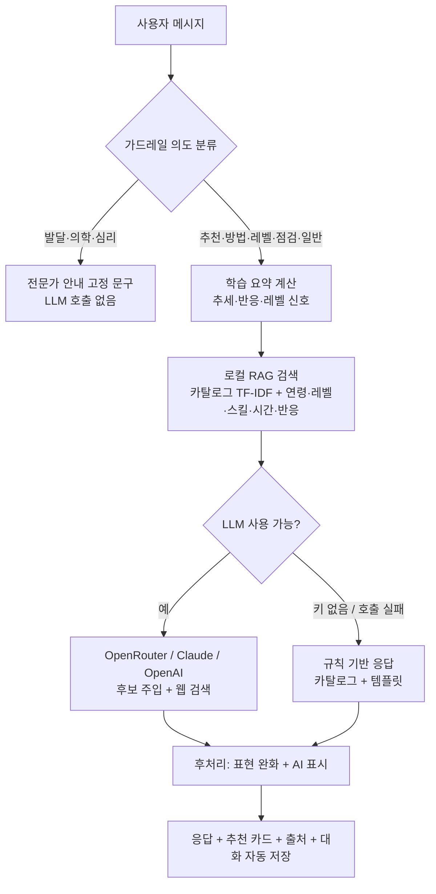

# 🧭 Compass — 전 연령 영어 학습 콘텐츠 추천 AI 에이전트

3세 유아(보호자 사용)부터 초·중·고 학생, 성인까지 — 학습자의 **연령대·레벨·목표·학습 기록**을 보고 "지금 나에게 맞는 영어 콘텐츠"를 **이유와 함께** 추천하는 AI 에이전트 웹 서비스입니다.

Bloomy(4~7세 데일리 코칭 서비스)의 AI 추천 부분을 떼어 내 전 연령용 독립 에이전트로 만들었습니다. Bloomy에서 검증한 **큐레이션 카탈로그 + 로컬 RAG 검색**, **Claude/OpenAI 제공자 추상화와 규칙 기반 폴백**, **발달·진단 질문 가드레일**, **학습 반응 기반 재정렬** 방식을 계승했습니다.

## 핵심 특징

| 기능 | 설명 |
|---|---|
| **근거 있는 추천 (RAG)** | 전 연령 큐레이션 카탈로그(49개, L1~L6)를 TF-IDF로 검색해 연령대·레벨(±1)·목표 스킬·하루 학습 시간·무료 선호로 거른 뒤, 그 결과를 "검수된 후보"로 AI에 주입 |
| **추천마다 이유** | "L4 기초 읽기 수준에 맞음 (L3~L5)", "목표 스킬 '읽기'와 직접 연결", "하루 30분 안에 가능"처럼 점수 근거를 사람이 읽을 수 있는 이유로 함께 제공 |
| **웹 검색 보완** | Claude `web_search` / OpenRouter `web` 플러그인 / OpenAI `web_search_preview`로 카탈로그 밖 최신 자료를 찾아 출처 링크("참고 출처")와 함께 제시 |
| **키 없이도 동작** | API 키가 없거나 호출이 실패하면 같은 카탈로그·규칙으로 답하는 **오프라인 추천 모드**로 자동 전환 (Bloomy 원칙) |
| **학습 기록이 추천을 바꾼다** | 추천 카드에서 「기록하기」 → 콘텐츠와 연결된 기록(쉬움/적정/어려움)이 쌓이면 '적정' 반복 자료는 올리고 '어려움' 반복 자료는 내림 |
| **레벨 재점검 신호** | 최근 10개 기록 중 7개 이상이 '쉬움'/'어려움'이면 한 단계 위/아래를 제안 (프로필은 사용자가 직접 확정) |
| **연령대별 레벨 체크리스트** | 3~6세(보호자 관찰형)부터 성인(CEFR 참고)까지 L1~L6 자기 점검 |
| **가드레일** | 발달·의학·심리 판단 요청은 LLM을 부르지 않고 전문가 안내, 보장·평가 표현 완화, 모든 응답에 "AI가 작성했습니다" 표시 |
| **집중 시간 원칙** | "스스로 집중해서 들인 시간이 영어를 자라게 한다" — 채팅 배너·요약 화면·모든 응답에서 리마인드 |

## 화면 (바닐라 HTML/CSS/JS, 모바일 퍼스트, 다크 모드)

| 탭 | 내용 |
|---|---|
| 💬 채팅 | 첫 방문 연령대 선택, 빠른 질문 칩, AI 답변 + 카탈로그 추천 카드 + 웹 출처, 동작 모드 표시, 새 대화 / 레벨 다시 보기 |
| 🎯 추천 | 프로필·기록 기반 추천 카드 (스킬 필터, 무료만 보기), 카드에서 바로 「기록하기」 |
| 📝 기록 | 학습 기록 CRUD (날짜·시간·내용·스킬·느낌·카탈로그 연결) |
| 🗂 대화 | 저장된 대화 목록, 불러오기(추천 카드·출처까지 복원), 삭제 |
| 📊 요약 | 핵심 원칙, 레벨 재점검 제안, 통계(총량·학습한 날·최근 7일·추세·연속·주간 목표), 스킬 분포, 14일 차트, 프로필 |

## 로컬 실행

필요: **Python 3.10 이상** (macOS/Linux 기준, Windows는 아래 수동 실행 참고)

```bash
./run.sh
```

처음 실행하면 `.venv` 생성 → 패키지 설치 → `.env` 생성(`.env.example` 복사)까지 자동으로 하고 서버를 띄웁니다.

- 서비스: http://127.0.0.1:8000
- API 문서(Swagger): http://127.0.0.1:8000/docs
- 데이터: `.data/compass.json`에 저장되어 재시작해도 유지됩니다

**AI 모드 켜기**: `.env`에 `OPENROUTER_API_KEY=...`(또는 `ANTHROPIC_API_KEY`, `OPENAI_API_KEY`)를 넣고 다시 실행하세요. 키가 없으면 헤더에 "📚 오프라인 추천"이 표시되고 카탈로그 규칙 기반으로 답합니다.

| 명령 | 설명 |
|---|---|
| `./run.sh` | 서버 실행 (코드 변경 시 자동 재시작) |
| `./run.sh test` | 스모크 테스트 — 인메모리·오프라인 모드로 단위 로직 + 전 API 검증 (API 키·네트워크 불필요) |
| `./run.sh seed --persona adult` | 샘플 프로필 + 학습 기록 약 150개 저장 (`adult`·`teen`·`child`·`preschool`, `--reset`으로 초기화 후 저장, `--dry-run`으로 미리보기) |
| `./run.sh setup` | 가상환경·패키지 설치만 |

<details>
<summary>수동 실행 (Windows 포함)</summary>

```bash
python -m venv .venv
# macOS/Linux: source .venv/bin/activate   ·   Windows: .venv\Scripts\activate
pip install -r requirements.txt
cp .env.example .env          # Windows: copy .env.example .env
python backend/main.py
```

테스트: `python scripts/smoke_test.py` · 시드: `python scripts/seed_records.py --persona adult`
</details>

## 환경 변수

모두 선택입니다. 아무것도 설정하지 않으면 오프라인 추천 + 로컬 파일 저장으로 동작합니다.

| 변수 | 기본값 | 설명 |
|---|---|---|
| `LLM_PROVIDER` | `auto` | `auto`(OpenRouter 키 → OpenRouter, 없으면 Anthropic 키 → Claude, 없으면 OpenAI 키 → OpenAI, 모두 없으면 local) · `openrouter` · `anthropic` · `openai` · `local` |
| `OPENROUTER_API_KEY` | — | OpenRouter API 키 — 키 하나로 Claude·GPT 등 여러 모델 사용 |
| `OPENROUTER_MODEL` | `anthropic/claude-opus-5.5` | OpenRouter 모델 ID (저렴하게: `anthropic/claude-haiku-5.5`, `openai/gpt-4o-mini`) |
| `OPENROUTER_BASE_URL` | `https://openrouter.ai/api/v1` | 보통 변경 불필요 |
| `ANTHROPIC_API_KEY` | — | Claude API 키 |
| `ANTHROPIC_MODEL` | `claude-opus-5-5` | 비용을 낮추려면 `claude-haiku-5-5` (Bloomy 배포본과 동일) |
| `CLAUDE_EFFORT` | `low` | Claude 생각 깊이 `low`·`medium`·`high` (OpenRouter의 `anthropic/*` 모델에도 적용) |
| `OPENAI_API_KEY` | — | OpenAI API 키 |
| `OPENAI_MODEL` | `gpt-4o-mini` | 웹 검색 도구를 지원하는 모델 권장 |
| `ENABLE_WEB_SEARCH` | `true` | 웹 검색 on/off. 거부되면 자동으로 검색 없이 재시도 |
| `STORE_BACKEND` | `auto` | `auto`(Firebase 키 → firestore, Vercel → memory, 로컬 → file) · `file` · `memory` · `firestore` |
| `DATA_FILE` | `.data/compass.json` | file 저장소 경로 |
| `FIREBASE_SERVICE_ACCOUNT_JSON` | — | Firestore 서비스 계정 키 JSON (한 줄) |
| `HOST` / `PORT` | `127.0.0.1` / `8000` | 로컬 서버 주소 |
| `ALLOWED_ORIGINS` | `*` | CORS 허용 오리진 (쉼표 구분) |

> Claude 웹 검색은 [Claude Console](https://console.anthropic.com)에서 조직의 웹 검색 사용이 허용되어 있어야 합니다. 허용되지 않았으면 검색 없이 카탈로그·지식 기반으로 답하고 안내 문구를 붙입니다.
> `claude-opus-5-5`에는 안전 분류기 거절 시 다른 모델로 자동 재시도하는 서버 측 fallback(`fallbacks: "default"`)을 켜 두었습니다.

## 에이전트 동작



## 기술 스택

- **백엔드**: Python 3.10+, FastAPI, Pydantic v2
- **AI**: Anthropic Python SDK(Claude + 서버 측 웹 검색) / OpenRouter(OpenAI 호환 API + web 플러그인) / OpenAI Responses API(+ 웹 검색) / 로컬 TF-IDF RAG (외부 모델 다운로드 없음)
- **저장소**: 로컬 JSON 파일(원자적 쓰기) · Firebase Firestore · 인메모리
- **프론트엔드**: HTML/CSS/JS (프레임워크 없음) — 백엔드가 같은 주소에서 정적 서빙
- **배포**: Vercel (`@vercel/python`, API + 프론트엔드 단일 URL)

## API

| Method | Path | 설명 |
|---|---|---|
| POST | /api/chat | AI 채팅 → `reply`, `recommendations`(카드), `sources`, `mode`, `intent`, `warnings`, `conversation_id` |
| GET | /api/recommendations | 프로필·기록 기반 카탈로그 추천 (`skill`, `q`, `free_only`, `limit`) — LLM 비용 없음 |
| GET | /api/catalog | 카탈로그 목록 (`age_band`, `level`, `skill`, `cost` 필터) |
| GET | /api/catalog/{id} | 카탈로그 항목 |
| POST / GET | /api/data | 학습 기록 추가 / 목록 |
| PUT / DELETE | /api/data/{id} | 학습 기록 수정 / 삭제 |
| GET | /api/data/summary | 학습 요약 (프롬프트 주입 + 요약 화면) |
| POST / GET | /api/conversations | 대화 저장 / 목록 |
| GET / DELETE | /api/conversations/{id} | 대화 조회 / 삭제 |
| GET / PUT | /api/profile | 프로필 조회 / 수정 (보낸 필드만 갱신, `null`이면 비움) |
| GET | /api/health | 상태 (LLM 제공자·모델·웹 검색, 저장소, 카탈로그 수) |

## 프로젝트 구조

```
├── run.sh                     # 로컬 실행 (setup · test · seed)
├── backend/
│   ├── main.py                # 앱 초기화, CORS, 정적 서빙, 헬스체크
│   ├── config.py              # 환경 변수 (루트 .env)
│   ├── data/catalog.json      # 전 연령 큐레이션 카탈로그 (RAG 코퍼스)
│   ├── models/schemas.py      # Pydantic 검증
│   ├── routers/               # chat · catalog · data · conversations · profile
│   └── services/
│       ├── agent.py           # 에이전트 오케스트레이터 (분류 → 요약 → 검색 → LLM/로컬 → 후처리)
│       ├── guardrails.py      # 의도 분류, 범위 밖 안내, 응답 후처리
│       ├── retriever.py       # TF-IDF 검색 + 프로필 필터 + 반응 재정렬 + 이유 생성
│       ├── catalog.py         # 카탈로그 로드·검증·카드 변환
│       ├── analysis.py        # 학습 요약, 레벨 재점검 신호, 콘텐츠별 반응
│       ├── prompts.py         # 시스템 프롬프트 (버전 관리)
│       ├── local_coach.py     # 오프라인 규칙 기반 응답 (추천·레벨·점검·방법)
│       ├── store.py           # file · memory · firestore 저장소
│       └── llm/               # 제공자 선택 + openrouter · anthropic · openai provider
├── frontend/                  # index.html · style.css · app.js
└── scripts/
    ├── seed_records.py        # 페르소나별 샘플 프로필·기록
    └── smoke_test.py          # 단위 + API 스모크 테스트 (오프라인)
```

## 카탈로그 관리

`backend/data/catalog.json`이 추천의 1차 근거입니다. 항목을 추가하면 서버 시작 시 필드를 검증합니다(https 링크, 연령대, `level_min ≤ level_max`, 유료면 `price_note` 필수 등). 링크는 각 서비스의 공식 홈페이지 기준이며, 서비스 개편으로 바뀔 수 있으니 주기적으로 확인하세요.

## Vercel 배포

1. GitHub에 푸시 → Vercel에서 import (`vercel.json`으로 FastAPI 서버리스 빌드)
2. 환경 변수 설정: `OPENROUTER_API_KEY`(또는 `ANTHROPIC_API_KEY`·`OPENAI_API_KEY`), 영속 저장이 필요하면 `FIREBASE_SERVICE_ACCOUNT_JSON`
3. 배포 URL에서 서비스와 `/docs` 확인

> Vercel은 파일시스템이 읽기 전용이라 Firebase 키가 없으면 인메모리 저장소로 동작합니다(콜드스타트 시 데이터 초기화).

## 윤리 원칙 (Bloomy 계승)

- 레벨은 평가가 아니라 **다음 추천을 고르는 도구** — 서열·진단 표현 금지
- 발달·건강·심리 판단은 하지 않고 전문가에게 안내
- 효과 보장 표현 금지, 유료 자료는 가격과 무료 대안 명시
- AI가 만든 응답은 항상 "AI가 작성했습니다" 표시
- 개인정보 최소화: 연령대만 수집 (생일·이름 없음)
